# DevCollab

DevCollab is a multi-user workspace for software teams. A workspace has members, projects, and numbered issues. People assign work, comment, mention teammates, follow issues, and mark blockers. The overview reads live counts from MongoDB. Updates and the inbox travel over Socket.IO.

It is a team system with shared data, roles, and authorization. It is not a personal timer or habit tracker.

## Preview

A new account opens on a starter workspace that already has a project, a board, and activity. The seeded team below is a second workspace, Northwind Labs, with two projects (`API` and `WEB`), blockers, a follower, and a markdown comment.

Sign in as `maya@devcollab.dev` / `Password123!`. Jonah Patel (`jonah@devcollab.dev`) is an admin and Priya Nair (`priya@devcollab.dev`) is a member. The same password works for all three. These accounts are demo data, not production credentials.

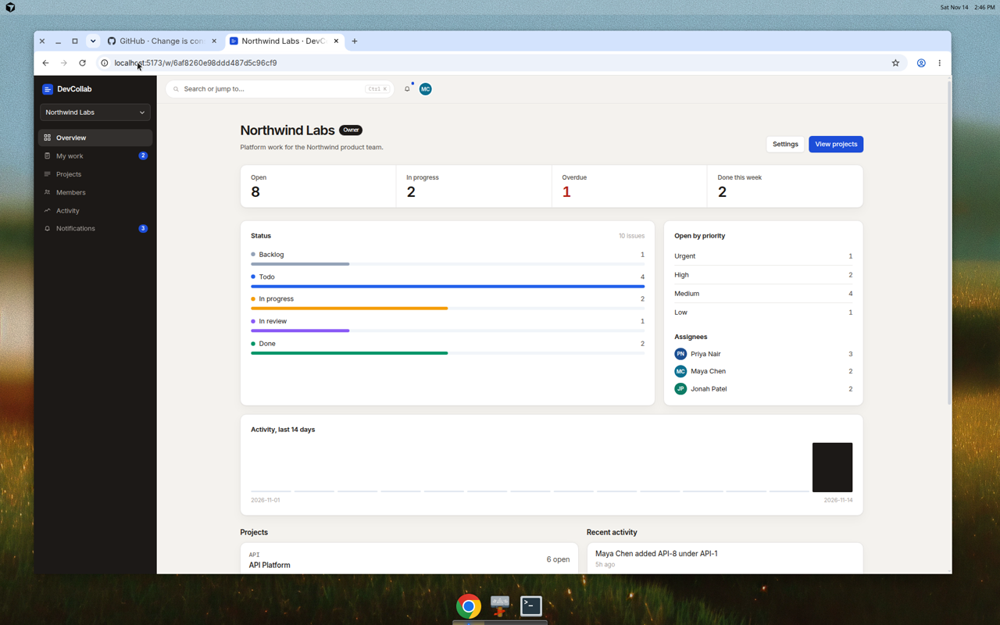

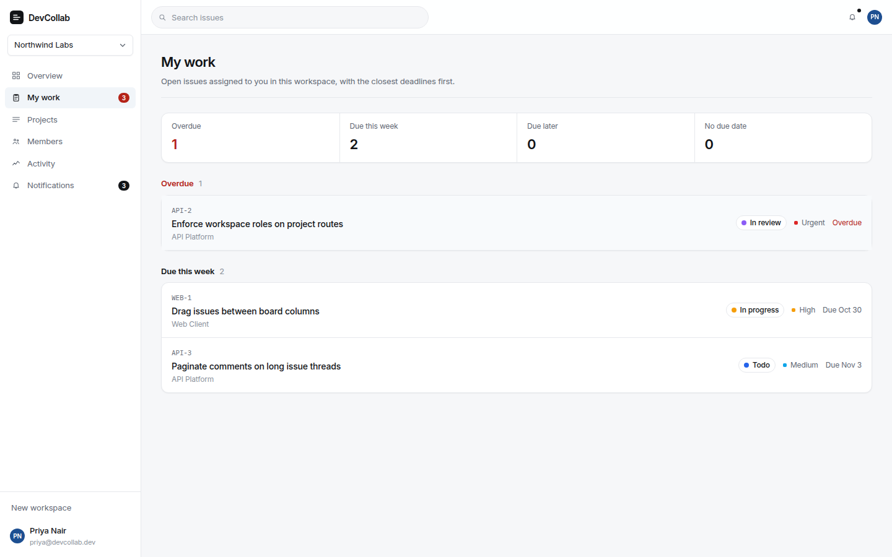

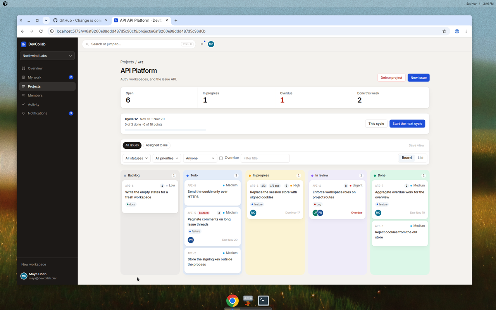

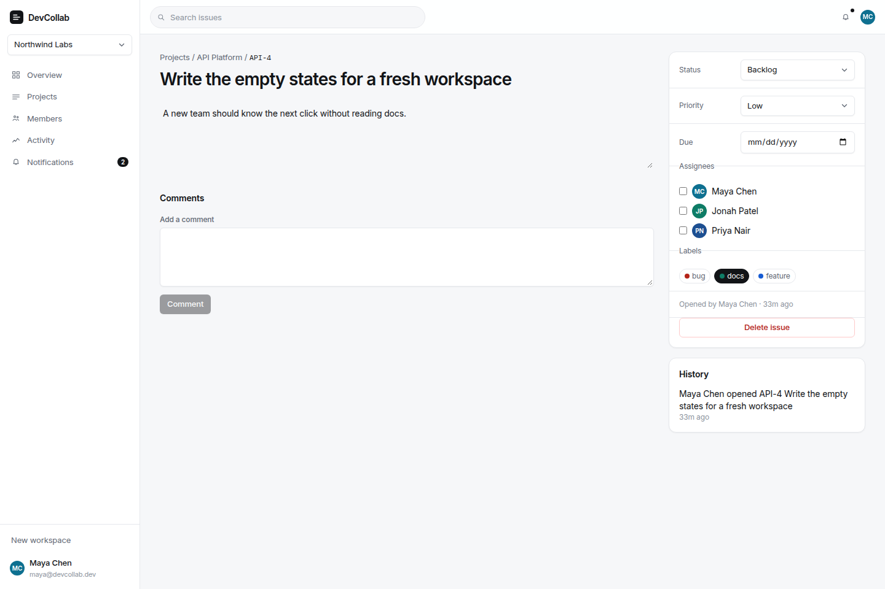

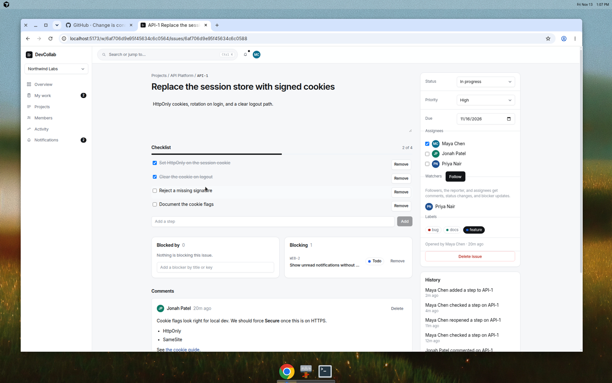

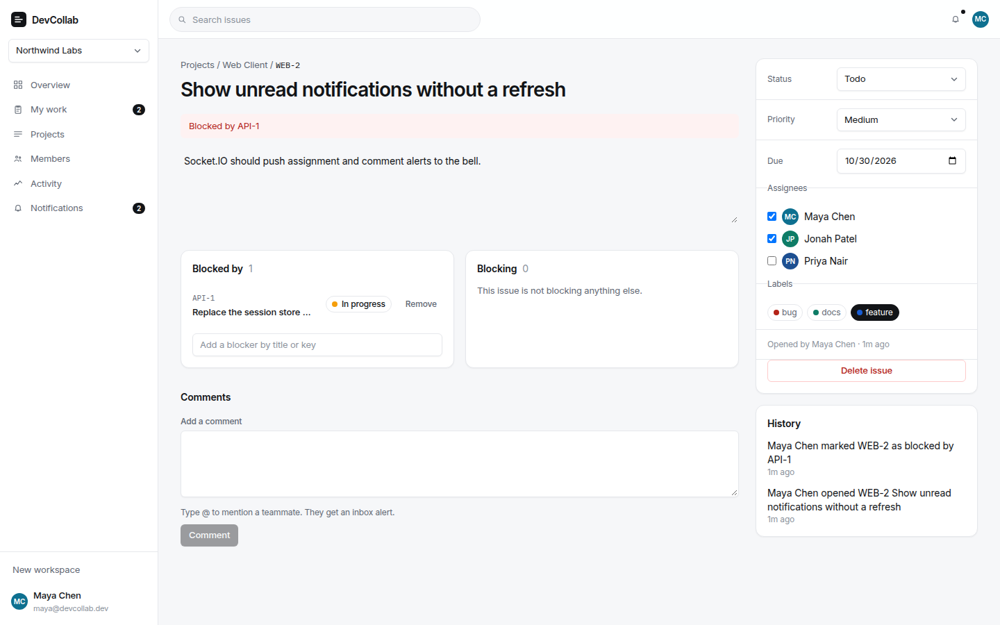

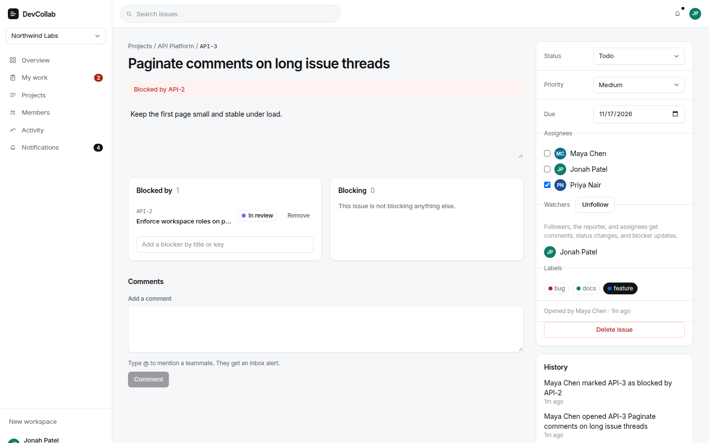

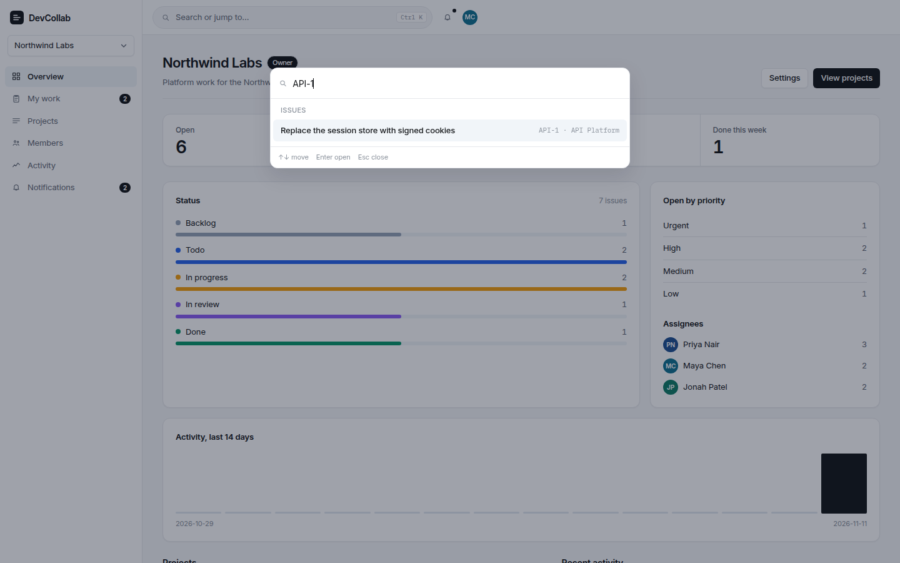

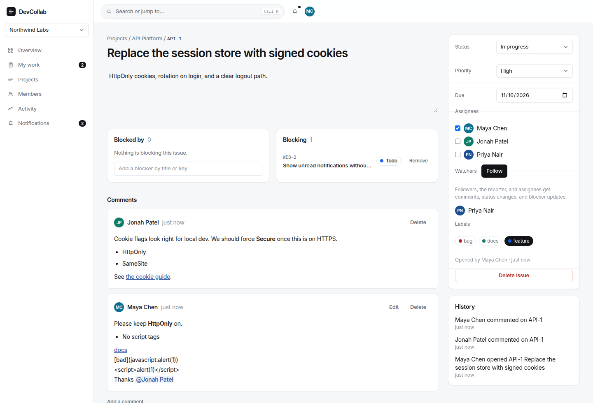

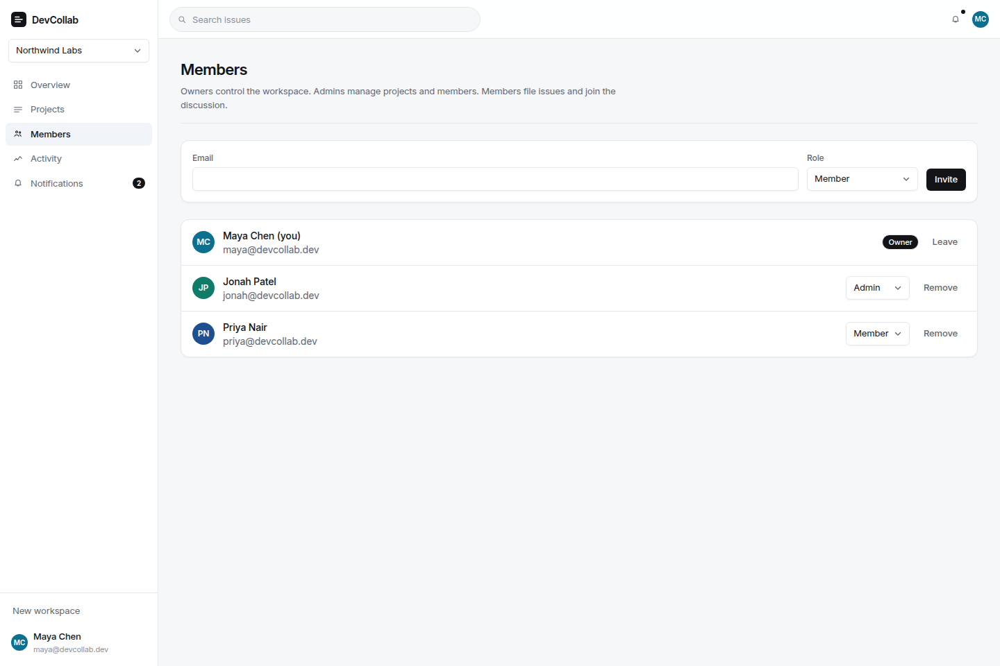

## Features

Accounts and access:

- Email and password accounts, bcrypt hashing, and an httpOnly JWT cookie
- Workspaces with owner, admin, and member roles
- Email invites for people who already have an account, and one-time links for everyone else
- A starter workspace on signup, so the first session is not an empty board

Work:

- Projects with short keys (`API-12`) and per-project issue numbers
- Issues with status, priority, labels, assignees, due dates, comments, and history
- A board you can drag between columns, plus a list view
- Filters, text search, and pagination
- Saved project views, private or shared. A view assigned to “me” follows whoever opens it
- My work, the open issues assigned to you: overdue, due this week, due later, and no due date
- Blockers inside one workspace. The issue, the board, and My work show the mark while a blocker is open, and clear it when that blocker is done
- A checklist on an issue. Steps can be renamed, checked, and removed, and the board, list, and My work show how many are done
- A command menu, opened with Ctrl K or ⌘K, that jumps to a page, a project, or an issue key

Discussion:

- @mentions in comments, which notify that person in their inbox and over the live connection
- Comment markdown for bold, lists, and links. The rules are in the next section
- Watchers. Any member can follow an issue and get the comment, status, and blocker alerts that the reporter and assignees already get

Workspace:

- Workspace and project analytics: open work, overdue issues, completions this week, status mix, and 14 days of activity
- Real-time issue, comment, view, and notification events for other members
- API integration tests, authorization tests, and a frontend suite

## Comment formatting

A comment is stored as text. The browser renders a small subset and never inserts the comment as HTML.

| You write | What people see |
| --- | --- |
| `**Secure**` or `__Secure__` | Bold text |
| A line starting with `- ` or `* ` | A bullet |
| A line starting with `1. ` | A numbered item |
| `[the guide](https://example.com)` | A link that opens in a new tab |

Only `http` and `https` addresses become links. HTML, `javascript:` URLs, and other markup stay as text. `@Priya Nair` still mentions a workspace member, including inside bold text or a link label. An unknown `@name` is left as text.

## Architecture

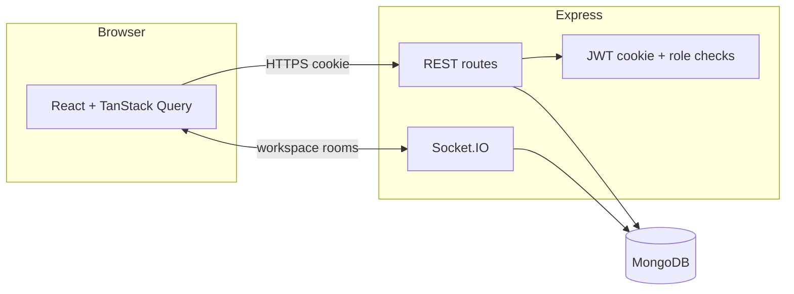

| Layer | Choice |
| --- | --- |
| UI | React, TypeScript, Tailwind, React Router |
| Client state | Zustand for the session and toasts, TanStack Query for server data |
| API | Node.js, Express, Zod validation |
| Data | MongoDB, Mongoose, aggregation for analytics |
| Auth | bcrypt, JWT in an httpOnly cookie, role checks on every workspace resource |
| Live updates | Socket.IO rooms per workspace and per user |
| Tests | Vitest, Supertest, React Testing Library, mongodb-memory-server |

```
client/     React application
server/     Express API, Socket.IO, Mongoose models
```

The production server can also serve `client/dist`, so cookies stay on one origin. Split hosting is supported with `VITE_API_URL` and `CLIENT_ORIGIN`.

## Roles

| Action | Owner | Admin | Member |
| --- | --- | --- | --- |
| View workspace, file issues, comment | Yes | Yes | Yes |
| Invite members, edit workspace settings | Yes | Yes | No |
| Invite or promote admins and owners | Yes | No | No |
| Delete a project | Yes | Yes | No |
| Delete the workspace | Yes | No | No |
| Delete someone else's issue or comment | Yes | Yes | No |

A workspace always keeps at least one owner. Someone who is not a member gets a 404 for that workspace, project, or issue, so private ids are not confirmed. A member who lacks the role gets a 403.

Passwords are hashed with bcrypt (12 rounds in production, fewer in tests). The session cookie is `HttpOnly`. `SameSite=Lax` is the default, which blocks cross-site form posts. Cross-site deployments (Vercel frontend, API on another host) need `COOKIE_SAMESITE=none` and `COOKIE_SECURE=true`. Invite tokens are stored as SHA-256 hashes and shown once.

## Local setup

Requirements: Node.js 20 or newer. MongoDB is optional for development.

```bash
npm install
npm --prefix server install
npm --prefix client install
cp server/.env.example server/.env
```

Use a real database:

```bash
# server/.env
MONGODB_URI=mongodb://127.0.0.1:27017/devcollab
```

Or an in-memory database that lives only as long as the API process:

```bash
# server/.env
MONGODB_URI=memory
SEED=true
```

Start both apps:

```bash
npm run dev
```

- UI: http://localhost:5173
- API: http://localhost:4000/api/health

With `SEED=true`, the Northwind accounts from the preview are available alongside the starter workspace created for any new registration.

To seed a persistent database instead:

```bash
npm run seed
```

## Scripts

| Command | What it does |
| --- | --- |
| `npm run dev` | API with reload, and the Vite client |
| `npm test` | Server tests, then client tests |
| `npm run build` | Production client bundle and compiled API |
| `npm start` | Runs the compiled API |
| `npm run seed` | Inserts the Northwind demo workspace |
| `npm --prefix server run loadtest` | 100 concurrent health checks, prints latency |

## API

Authenticated routes expect the session cookie. Collection responses are paginated as `{ page, limit, total, pages }` where a list is involved. Errors look like `{ error: { message, code, details } }`.

| Method | Path | Purpose |
| --- | --- | --- |
| POST | `/api/auth/register` | Create an account |
| POST | `/api/auth/login` | Start a session |
| POST | `/api/auth/logout` | Clear the cookie |
| GET, PATCH | `/api/auth/me` | Current user, or rename |
| GET, POST | `/api/workspaces` | List or create |
| GET, PATCH, DELETE | `/api/workspaces/:id` | Read, update, or delete |
| GET | `/api/workspaces/:id/members` | Members |
| POST | `/api/workspaces/:id/invites` | Add a user or mint an invite link |
| POST | `/api/invites/:token/accept` | Accept an invite |
| GET, POST | `/api/workspaces/:id/projects` | Projects in a workspace |
| GET, PATCH, DELETE | `/api/projects/:id` | Read, update, or delete a project |
| GET, POST | `/api/projects/:id/issues` | Filtered, paginated issues. `assignee=me` means the signed-in user |
| GET | `/api/issues/:id` | One issue, including blockers and whether you follow it |
| PATCH, DELETE | `/api/issues/:id` | Update or delete an issue |
| POST | `/api/issues/:id/blockers` | Block this issue on another issue in the same workspace |
| DELETE | `/api/issues/:id/blockers/:blockerId` | Remove that blocker |
| POST, DELETE | `/api/issues/:id/watch` | Follow or unfollow an issue |
| POST | `/api/issues/:id/checklist` | Add a step. An issue holds at most 30 |
| PATCH | `/api/issues/:id/checklist/:itemId` | Rename a step or mark it done |
| DELETE | `/api/issues/:id/checklist/:itemId` | Remove a step |
| GET, POST | `/api/issues/:id/comments` | Discussion. The body is plain text; the client renders the markdown subset |
| PATCH, DELETE | `/api/comments/:id` | Edit your comment, or delete it when you are the author or an admin |
| GET, POST, DELETE | `/api/projects/:id/views` | Saved filters for a project. Private views stay with their author; shared views are visible to the project |
| GET | `/api/workspaces/:id/my-work` | Open issues assigned to the signed-in user |
| GET | `/api/workspaces/:id/search?q=` | Issues by title, or by key such as `API-12` |
| GET, POST, DELETE | `/api/workspaces/:id/labels` | Workspace labels. Deleting one requires an admin |
| GET | `/api/workspaces/:id/activity` | Workspace history |
| GET | `/api/projects/:id/activity` | Project history |
| GET | `/api/issues/:id/activity` | Issue history |
| GET | `/api/workspaces/:id/analytics` | Workspace totals |
| GET | `/api/projects/:id/analytics` | Project totals |
| GET | `/api/notifications` | Inbox |
| POST | `/api/notifications/read-all` | Mark the inbox read |
| PATCH | `/api/notifications/:id/read` | Mark one notification read |
| GET | `/api/health` | Process and database status |

Issue list filters: `status`, `priority`, `assignee`, `label`, `q`, `overdue`, `page`, `limit`, `sort` (`updated`, `created`, `due`, `priority`).

Socket.IO authenticates with the same cookie. Clients emit `workspace:join` with a workspace id. The server checks membership before joining `workspace:{id}`. Each connection also joins `user:{id}` for notifications. Events: `issue:created`, `issue:updated`, `issue:deleted`, `comment:created`, `comment:updated`, `comment:deleted`, `view:saved`, `view:deleted`, `activity:created`, `notification:created`.

## Tests

Server tests cover registration, cookie sessions, duplicate emails, role boundaries, invite links, issue numbers, filters, pagination, comments, mentions, saved views, My work, blockers, watchers, checklists, notifications, analytics, and a Socket.IO broadcast. Client tests cover formatting, mentions, the command menu, comment markdown, checklist progress, saved-view filters, and the login form. The server boots MongoDB in memory, so the suite does not need a local database.

```bash
npm test
```

## Deployment

### Docker

```bash
docker compose up --build
```

The app is served at http://localhost:4000 with MongoDB 7. Seed it from another terminal only if you point `MONGODB_URI` at `mongodb://127.0.0.1:27017/devcollab` and run `npm run seed` on the host, or set `SEED=true` on the app service for the first boot.

### Render and MongoDB Atlas

`render.yaml` builds the client and the API, then starts one web service. Create an Atlas cluster, set `MONGODB_URI`, and set `CLIENT_ORIGIN` to the service's public `https://` URL. The health check is `/api/health`.

Atlas network access must allow the Render service. The filesystem is ephemeral, so uploads are not part of this app. Data lives in MongoDB.

### Split hosting

Build the client with `VITE_API_URL=https://your-api.example.com` and deploy `client/` to Vercel (`client/vercel.json` rewrites SPA routes). On the API set:

```
CLIENT_ORIGIN=https://your-app.vercel.app
COOKIE_SECURE=true
COOKIE_SAMESITE=none
```

## Data notes

- Issue numbers increment on the project document, so concurrent creates do not reuse a number.
- `completedAt` is set when an issue moves to Done and cleared if it is reopened. "Done this week" uses that field.
- `commentCount` is stored on the issue and updated when comments are added or removed.
- `blocked` stays true while any linked blocker is still open. Adding, removing, completing, reopening, or deleting a blocker updates it.
- Followers are stored on the issue. Removing someone from the workspace also removes their follows. The reporter and assignees are notified without having to follow.
- Checklist steps are stored on the issue in the order they were added. Checking a step does not change the issue status. The activity log records adds, checks, renames, and removals.
- Comment markdown is not stored as HTML. The client parses a fixed subset and renders React elements.
- Analytics use aggregation pipelines. Day buckets are UTC.
- List endpoints are paginated. The board requests up to 100 issues and says when the filter still has more.

## License

This project is sample application code for a portfolio. Add a license before you reuse it in a product.
