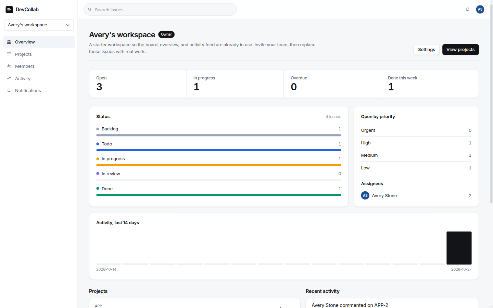
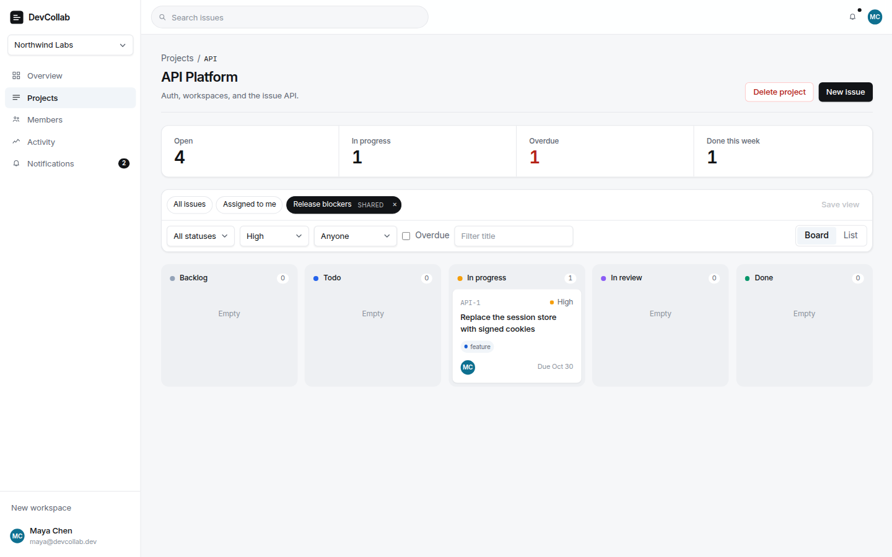
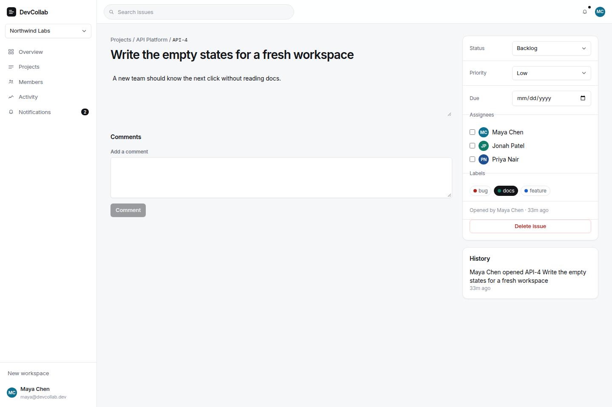
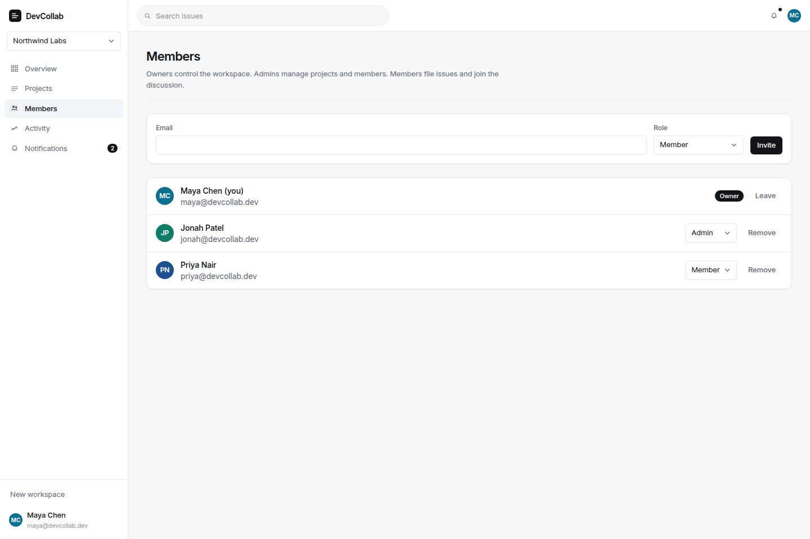
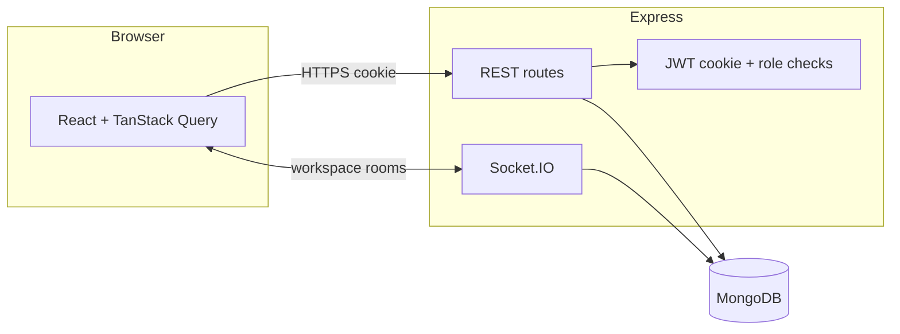

# DevCollab

DevCollab is a multi-user workspace for software teams. People create a workspace, invite teammates, organize work into projects, and track issues through discussion, assignments, and an activity history. Live updates and in-app notifications use Socket.IO. Analytics on the overview are aggregated from the database, not from sample charts.

It is a team system: shared data, roles, and authorization. It is not a personal timer or habit tracker.

## Preview

A new account opens on a workspace that already has a project, a board, and activity. The seeded team is `maya@devcollab.dev` / `Password123!`.









## Features

- Email and password accounts, bcrypt hashing, and an httpOnly JWT cookie
- Workspaces with owner, admin, and member roles
- Email invites for people who already have an account, and one-time links for everyone else
- Projects with short keys (`API-12`) and per-project issue numbers
- Issues with status, priority, labels, assignees, due dates, comments, and history
- A starter workspace on signup, with a project and sample issues so the first session is not an empty board
- @mentions in comments, which notify that person in their inbox and over the live connection
- Filters, text search, and pagination
- Saved project views, private or shared. A view assigned to “me” shows each person their own work
- A board you can drag between columns, plus a list view
- Workspace and project analytics: open work, overdue issues, completions this week, status mix, and 14 days of activity
- Real-time issue, comment, and notification events for other members
- API integration tests, authorization tests, and a small frontend suite

## Architecture



| Layer | Choice |
| --- | --- |
| UI | React, TypeScript, Tailwind, React Router |
| Client state | Zustand for the session and toasts, TanStack Query for server data |
| API | Node.js, Express, Zod validation |
| Data | MongoDB, Mongoose, aggregation for analytics |
| Auth | bcrypt, JWT in an httpOnly cookie, role checks on every workspace resource |
| Live updates | Socket.IO rooms per workspace and per user |
| Tests | Vitest, Supertest, React Testing Library, mongodb-memory-server |

```
client/     React application
server/     Express API, Socket.IO, Mongoose models
```

The production server can also serve `client/dist`, so cookies stay on one origin. Split hosting is supported with `VITE_API_URL` and `CLIENT_ORIGIN`.

## Roles

| Action | Owner | Admin | Member |
| --- | --- | --- | --- |
| View workspace, file issues, comment | Yes | Yes | Yes |
| Invite members, edit workspace settings | Yes | Yes | No |
| Invite or promote admins and owners | Yes | No | No |
| Delete a project | Yes | Yes | No |
| Delete the workspace | Yes | No | No |
| Delete someone else's issue or comment | Yes | Yes | No |

A workspace always keeps at least one owner. Someone who is not a member gets a 404 for that workspace, project, or issue, so private ids are not confirmed. A member who lacks the role gets a 403.

Passwords are hashed with bcrypt (12 rounds in production, fewer in tests). The session cookie is `HttpOnly`. `SameSite=Lax` is the default, which blocks cross-site form posts. Cross-site deployments (Vercel frontend, API on another host) need `COOKIE_SAMESITE=none` and `COOKIE_SECURE=true`. Invite tokens are stored as SHA-256 hashes and shown once.

## Local setup

Requirements: Node.js 20 or newer. MongoDB is optional for development.

```bash
npm install
npm --prefix server install
npm --prefix client install
cp server/.env.example server/.env
```

Use a real database:

```bash
# server/.env
MONGODB_URI=mongodb://127.0.0.1:27017/devcollab
```

Or an in-memory database that lives only as long as the API process:

```bash
# server/.env
MONGODB_URI=memory
SEED=true
```

Start both apps:

```bash
npm run dev
```

- UI: http://localhost:5173
- API: http://localhost:4000/api/health

With `SEED=true`, sign in as `maya@devcollab.dev` / `Password123!`. Jonah Patel (`jonah@devcollab.dev`) is an admin and Priya Nair (`priya@devcollab.dev`) is a member. The same password works for all three. This account is demo data, not a production credential.

To seed a persistent database instead:

```bash
npm run seed
```

## Scripts

| Command | What it does |
| --- | --- |
| `npm run dev` | API with reload, and the Vite client |
| `npm test` | Server tests, then client tests |
| `npm run build` | Production client bundle and compiled API |
| `npm start` | Runs the compiled API |
| `npm run seed` | Inserts the Northwind demo workspace |
| `npm --prefix server run loadtest` | 100 concurrent health checks, prints latency |

## API

Authenticated routes expect the session cookie. Collection responses are paginated as `{ page, limit, total, pages }` where a list is involved. Errors look like `{ error: { message, code, details } }`.

| Method | Path | Purpose |
| --- | --- | --- |
| POST | `/api/auth/register` | Create an account |
| POST | `/api/auth/login` | Start a session |
| POST | `/api/auth/logout` | Clear the cookie |
| GET, PATCH | `/api/auth/me` | Current user, or rename |
| GET, POST | `/api/workspaces` | List or create |
| GET, PATCH, DELETE | `/api/workspaces/:id` | Read, update, or delete |
| GET | `/api/workspaces/:id/members` | Members |
| POST | `/api/workspaces/:id/invites` | Add a user or mint an invite link |
| POST | `/api/invites/:token/accept` | Accept an invite |
| GET, POST | `/api/workspaces/:id/projects` | Projects in a workspace |
| GET, POST | `/api/projects/:id/issues` | Filtered, paginated issues. `assignee=me` means the signed-in user |
| GET, POST, DELETE | `/api/projects/:id/views` | Saved filters for a project. Private views stay with their author; shared views are visible to the project |
| PATCH, DELETE | `/api/issues/:id` | Update or delete an issue |
| GET, POST | `/api/issues/:id/comments` | Discussion |
| GET | `/api/workspaces/:id/analytics` | Workspace totals |
| GET | `/api/projects/:id/analytics` | Project totals |
| GET | `/api/notifications` | Inbox |
| GET | `/api/health` | Process and database status |

Issue list filters: `status`, `priority`, `assignee`, `label`, `q`, `overdue`, `page`, `limit`, `sort` (`updated`, `created`, `due`, `priority`).

Socket.IO authenticates with the same cookie. Clients emit `workspace:join` with a workspace id. The server checks membership before joining `workspace:{id}`. Each connection also joins `user:{id}` for notifications. Events: `issue:created`, `issue:updated`, `issue:deleted`, `comment:created`, `comment:deleted`, `activity:created`, `notification:created`.

## Tests

Server tests cover registration, cookie sessions, duplicate emails, role boundaries, invite links, issue numbers, filters, pagination, comments, notifications, analytics, and a Socket.IO broadcast. They boot MongoDB in memory, so they do not need a local database.

```bash
npm test
```

## Deployment

### Docker

```bash
docker compose up --build
```

The app is served at http://localhost:4000 with MongoDB 7. Seed it from another terminal only if you point `MONGODB_URI` at `mongodb://127.0.0.1:27017/devcollab` and run `npm run seed` on the host, or set `SEED=true` on the app service for the first boot.

### Render and MongoDB Atlas

`render.yaml` builds the client and the API, then starts one web service. Create an Atlas cluster, set `MONGODB_URI`, and set `CLIENT_ORIGIN` to the service's public `https://` URL. The health check is `/api/health`.

Atlas network access must allow the Render service. The filesystem is ephemeral, so uploads are not part of this app. Data lives in MongoDB.

### Split hosting

Build the client with `VITE_API_URL=https://your-api.example.com` and deploy `client/` to Vercel (`client/vercel.json` rewrites SPA routes). On the API set:

```
CLIENT_ORIGIN=https://your-app.vercel.app
COOKIE_SECURE=true
COOKIE_SAMESITE=none
```

## Data notes

- Issue numbers increment on the project document, so concurrent creates do not reuse a number.
- `completedAt` is set when an issue moves to Done and cleared if it is reopened. "Done this week" uses that field.
- `commentCount` is stored on the issue and updated when comments are added or removed.
- Analytics use aggregation pipelines. Day buckets are UTC.
- List endpoints are paginated. The board requests up to 100 issues and says when the filter still has more.

## License

This project is sample application code for a portfolio. Add a license before you reuse it in a product.
